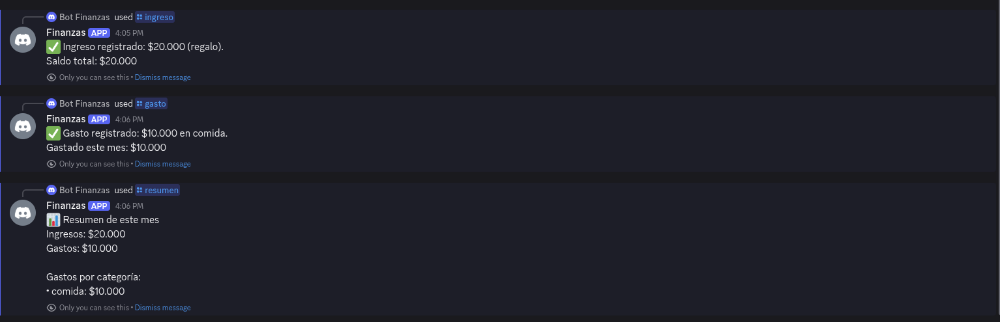
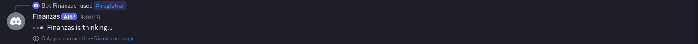
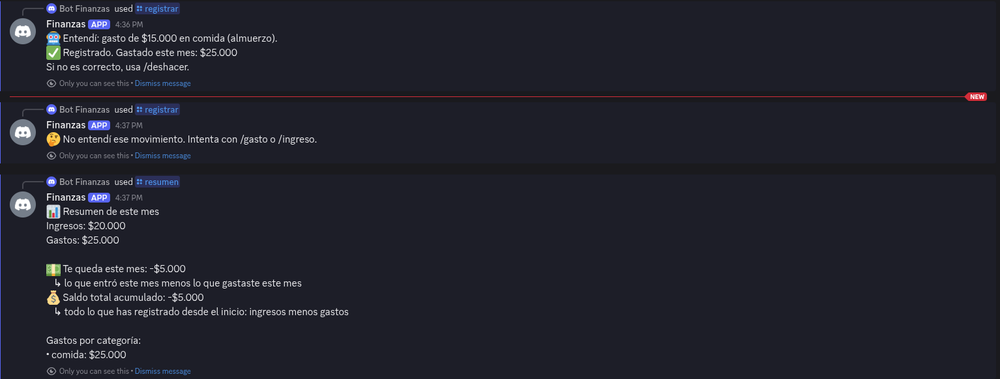

# bot-finanzas

Bot de finanzas personales: registra ingresos y gastos, y consulta saldos desde Discord.

## El bot en acción

Comandos: `/gasto`, `/ingreso`, `/saldo`, `/resumen`, `/deshacer`, `/registrar` (con IA) y `/ayuda`
(explica cómo usar el bot en palabras sencillas).
Cada respuesta es privada: solo la ve quien escribió el comando.

Comandos básicos (`/ingreso`, `/gasto`, `/resumen`):



`/registrar` responde de inmediato que está pensando, porque la IA tarda más que el límite de
3 segundos de Discord…



…y luego edita ese mensaje. Registra solo lo que pasa la validación; si no entiende, no guarda
nada. `/resumen` muestra cuánto queda en el periodo y el saldo total acumulado:



## Stack

| Componente | Herramienta |
|---|---|
| Canal de chat | Slash commands de Discord |
| Automatización | n8n (Docker; primero local, luego Render) |
| Base de datos | PostgreSQL (contenedor local, luego Supabase) |
| IA (`/registrar`) | Modelos gratuitos de OpenRouter, con respuesta diferida y validación por lista blanca |

## Configuración

1. Copia la plantilla de entorno y restringe sus permisos:

   ```bash
   cp .env.example .env && chmod 600 .env
   ```

2. Completa `.env`. Los valores marcados con `[SECRET]` no deben aparecer en chats ni en commits.

3. Inicia el stack local (Postgres, n8n y un túnel público temporal) y aplica las migraciones:

   ```bash
   docker compose --profile tunnel up -d
   for f in sql/0*.up.sql; do
     docker compose exec -T postgres sh -c 'psql -v ON_ERROR_STOP=1 -U "$POSTGRES_USER" -d "$POSTGRES_DB"' < "$f"
   done
   docker compose logs tunnel | grep -o 'https://.*trycloudflare.com'   # public URL
   ```

4. Activa los usuarios de mínimo privilegio y, en n8n (http://localhost:5678), crea la cuenta de
   propietario y una credencial de Postgres llamada `Postgres local` (host `postgres`, base de datos
   `finanzas`, usuario `bot_app`, contraseña `DB_BOT_PASSWORD` de `.env`). Para `/registrar`, crea
   también una credencial *Header Auth* llamada `OpenRouter` (header `Authorization`, valor
   `Bearer <OPENROUTER_API_KEY>`):

   ```bash
   scripts/setup-database.sh local
   ```

5. Despliega el workflow y registra los slash commands:

   ```bash
   scripts/deploy-workflow.sh workflows/discord-interactions.json discord-interactions
   scripts/register-commands.sh
   ```

6. En el Discord Developer Portal, configura **Interactions Endpoint URL** como
   `<tunnel URL>/webhook/discord-interactions`.

## Producción

```
Discord ──► Render (n8n, deploy/Dockerfile) ──► Supabase (PostgreSQL)
                 ▲
     cron-job.org hace ping a /healthz cada 10 minutos para que la instancia gratuita no se suspenda
```

| Componente | Ubicación | Notas |
|---|---|---|
| n8n | Servicio web gratuito de Render, Virginia | Se construye desde `deploy/Dockerfile`; los push no despliegan automáticamente |
| Estado de n8n | Supabase, esquema `n8n` | Rol `n8n_app`; la instancia de Render es desechable |
| Datos de dinero | Supabase, esquema `finance` | Rol `bot_app`: sin UPDATE, sin DDL |
| TLS hacia Supabase | `deploy/supabase-ca.crt` | Certificados verificados; nunca se desactiva la verificación |

Configuración desde cero:

1. `scripts/setup-database.sh supabase --migrate` aplica las migraciones y habilita los roles.
2. `scripts/cloud-n8n.sh up`; luego abre http://localhost:5679 para crear la cuenta de propietario
   una credencial de Postgres (`bot_app.<project-ref>`, SSL require) y la credencial *Header Auth*
   `OpenRouter` **antes** de que exista la
   instancia en la nube, para que su página de configuración nunca pueda ser reclamada públicamente.
3. `scripts/cloud-n8n.sh deploy workflows/discord-interactions.json <id postgres> "<nombre postgres>" <id openrouter> "<nombre openrouter>"`;
   luego `scripts/cloud-n8n.sh down`.
4. Crea el servicio en Render (Docker, `deploy/Dockerfile`, health check `/healthz`) con las
   variables indicadas en el ADR 0002, y apunta la Interactions Endpoint URL de Discord a
   `<render URL>/webhook/discord-interactions`.

Decisiones y mediciones: `docs/adr/0002-render-instead-of-hugging-face.md`.

## Pruebas

Todas las pruebas se ejecutan contra el Postgres y el n8n locales reales; no se simula nada.

| Script | Qué demuestra |
|---|---|
| `scripts/test-schema.sh` | Las restricciones de las tablas rechazan datos de dinero inválidos |
| `scripts/test-functions.sh` | Saldos, periodos (calendario de Bogotá), idempotencia, deshacer |
| `scripts/test-roles.sh` | Mínimo privilegio: qué pueden y qué no pueden hacer `bot_app` y `n8n_app` |
| `scripts/test-bot.sh` | El workflow de extremo a extremo: firmas, respuestas, escrituras en la base de datos y `/registrar` frente a respuestas válidas, maliciosas y fallidas de la IA (`scripts/stub-server.mjs` imita a OpenRouter y a Discord) |

## Documentación

- `docs/contract.md`: qué acepta y qué responde cada comando.
- `docs/workflow.md`: el workflow de n8n nodo por nodo, con capturas de pantalla.
- `docs/adr/`: decisiones de arquitectura y sus razones.
- `docs/bot-finanzas.pdf`: todo lo anterior en un solo PDF.

Los archivos Markdown son la fuente de verdad. Después de modificarlos o de modificar el workflow:

```bash
scripts/docs-screenshots.sh   # regenerates docs/images/ from a throwaway n8n
scripts/build-docs-pdf.sh     # regenerates docs/bot-finanzas.pdf
```

## Estructura

```
discord/    definiciones de los slash commands
docs/       contrato y registros de decisiones de arquitectura (ADR)
sql/        migraciones de la base de datos
workflows/  workflows de n8n exportados (JSON, sin secretos)
scripts/    scripts de pruebas y utilidades
```
