# El workflow de n8n, nodo por nodo

Archivo: `workflows/discord-interactions.json` (13 nodos). Las capturas de pantalla provienen de una
instancia desechable de n8n que importó exactamente este archivo; la credencial de Postgres que se muestra es un marcador de posición.

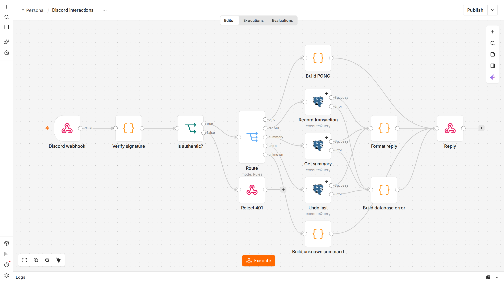

El flujo: Discord envía cada slash command al webhook. El bot comprueba que la solicitud
realmente proviene de Discord, la enruta según el comando, llama a una función SQL y responde en
la misma respuesta HTTP. Las reglas de negocio residen en PostgreSQL (`sql/`); n8n solo adapta
Discord a la base de datos.

## 1. Discord webhook

Recibe el `POST` de Discord en `/webhook/discord-interactions`. La opción **Raw Body** conserva
los bytes exactos que envió Discord, que la verificación de firma necesita. Las respuestas las genera
más adelante un nodo *Respond to Webhook*, de modo que la solicitud HTTP permanece abierta hasta que el bot tiene
una respuesta.

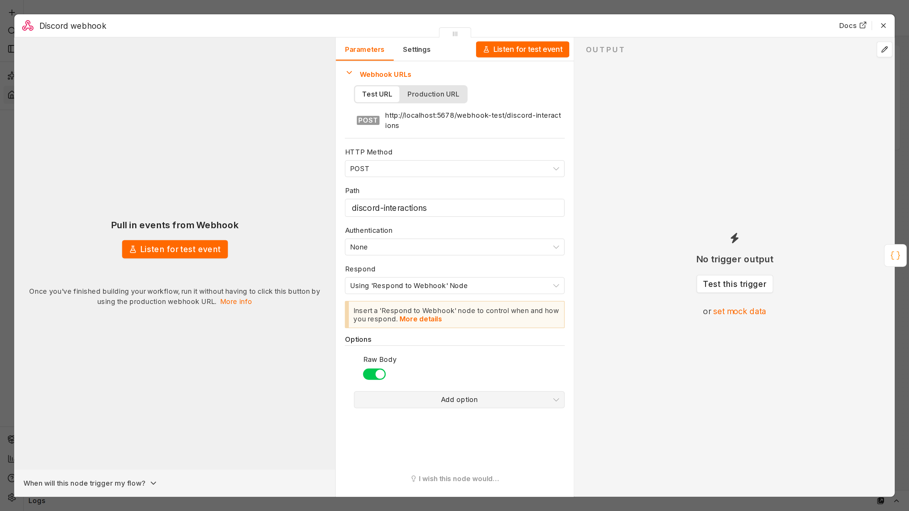

## 2. Verify signature

JavaScript (nodo Code). Discord firma `timestamp + raw body` con Ed25519; este nodo
la verifica con la clave **pública** de Discord, rechaza timestamps con más de 5 minutos de antigüedad
(solicitudes repetidas) y extrae el comando, sus opciones y el id de usuario de Discord.

Por qué los bytes sin procesar: el JSON analizado por n8n cambia valores como `1.50` a `1.5`, por lo que una verificación
contra JSON re-serializado rechazaría solicitudes legítimas.

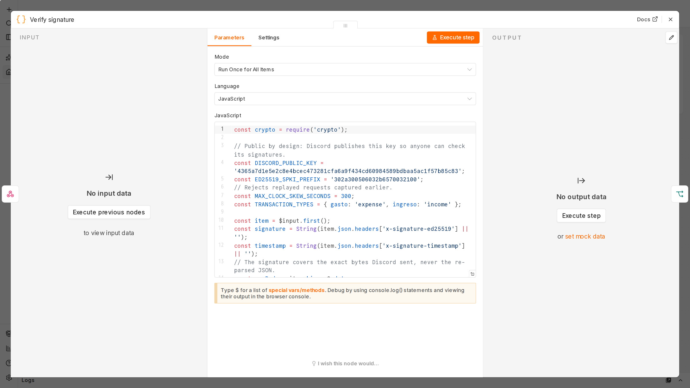

## 3. Is authentic?

Nodo `If` sobre el indicador `authentic`. Todo lo que no esté firmado por Discord va a *Reject 401*
y nunca llega a la base de datos.

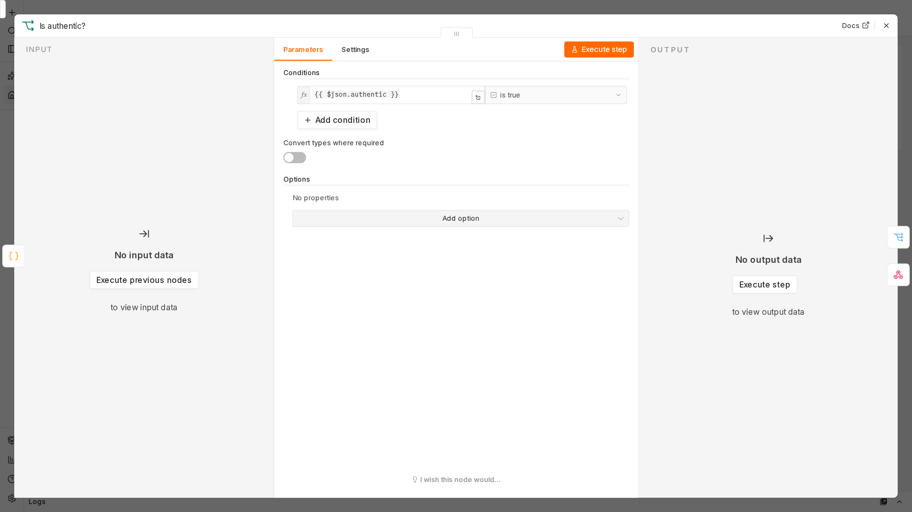

## 4. Reject 401

Responde `401 invalid request signature`. El propio Discord comprueba este comportamiento cuando se
guarda la Interactions Endpoint URL: envía una solicitud con una firma incorrecta y rechaza
la URL a menos que la respuesta sea 401.

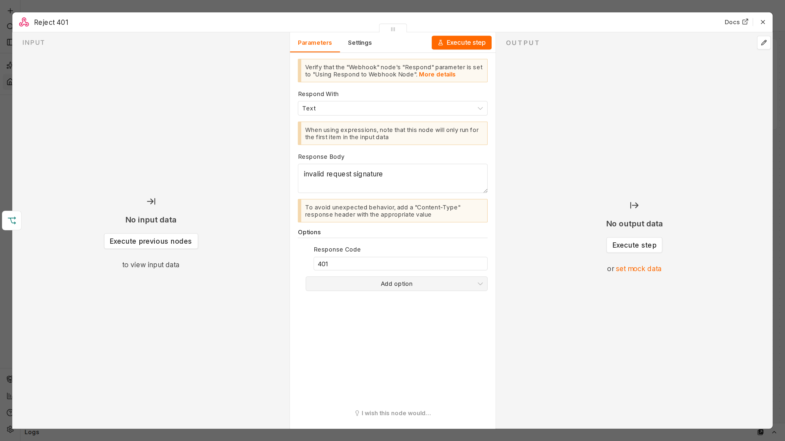

## 5. Route

Nodo `Switch` con cinco salidas: `ping` (la verificación de estado de Discord), `record`
(`/gasto`, `/ingreso`), `summary` (`/saldo`, `/resumen`), `undo` (`/deshacer`) y
`unknown` (alternativa por defecto).

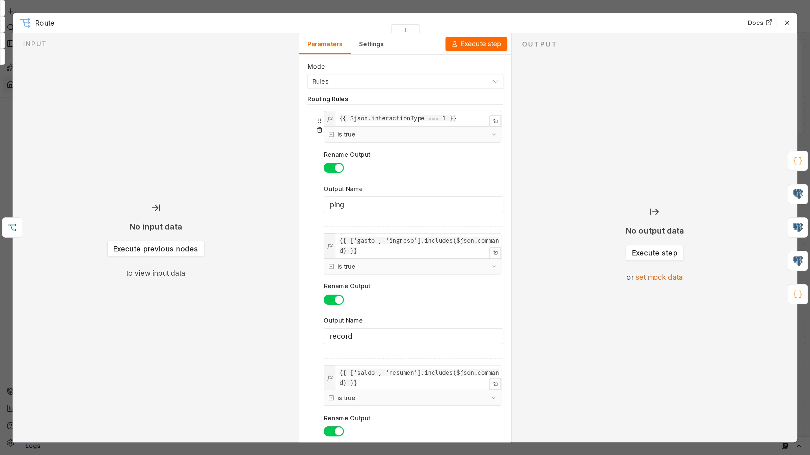

## 6. Build PONG

Responde al `PING` de Discord con `{"type": 1}`.

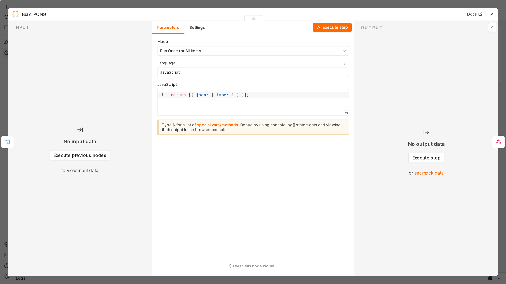

## 7. Record transaction

Llama a `finance.record_transaction($1, ... $6)`. Los valores viajan como **parámetros de consulta**,
nunca insertados en el texto SQL, lo que descarta la inyección SQL; una nota como
`arepa, tinto` se almacena con su coma intacta. La salida de error del nodo conduce a
*Build database error*, de modo que una inserción fallida nunca se confirma al usuario.

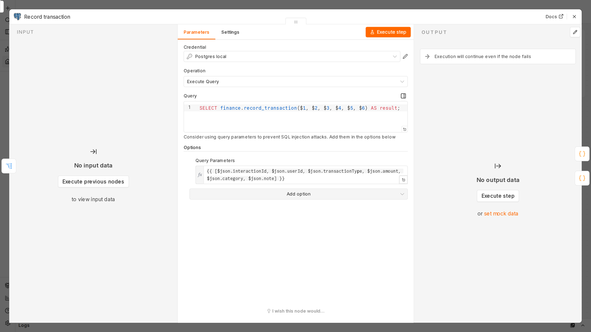

## 8. Get summary

Llama a `finance.summary(user, period)` para `/saldo` (mes en curso) y `/resumen`
(`hoy`, `semana`, `mes`, `año`, según el calendario de Bogotá).

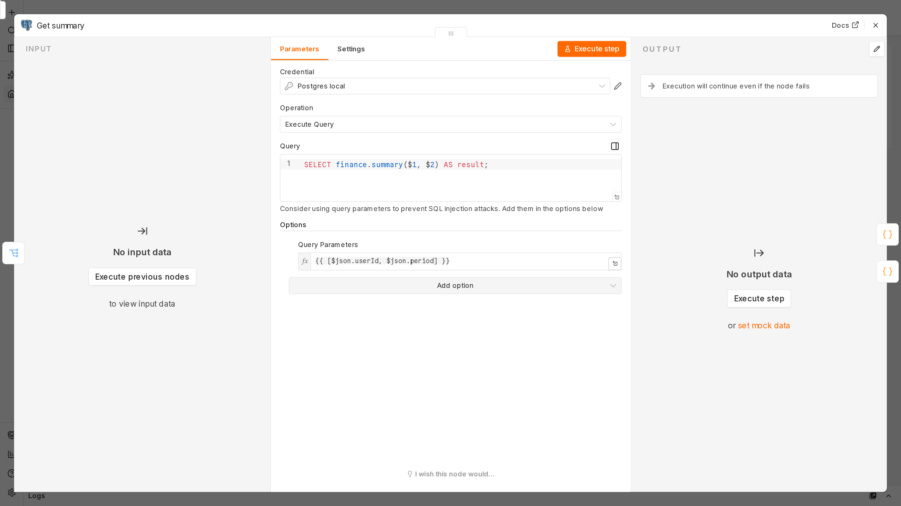

## 9. Undo last

Llama a `finance.undo_last(user)`, que elimina únicamente el movimiento más reciente de quien envía el comando.

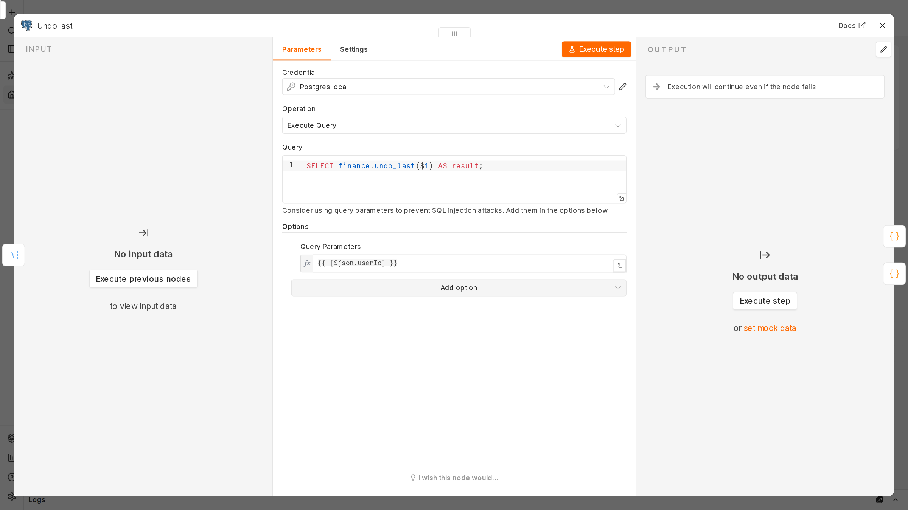

## 10. Build unknown command

Responde `No conozco ese comando.` para los comandos que el bot no conoce.

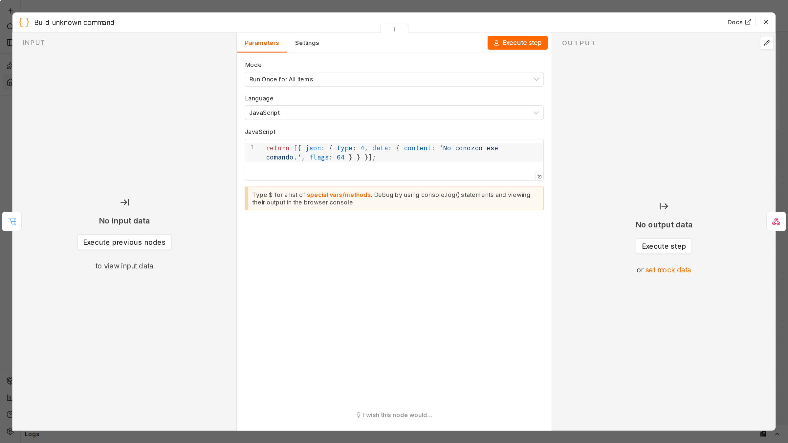

## 11. Format reply

Convierte el resultado SQL en los mensajes en español definidos en `docs/contract.md`, formatea
el dinero como pesos colombianos (`$1.500.000`, los negativos como `-$20.000`) y establece `flags: 64`
para que solo quien envía el comando vea la respuesta.

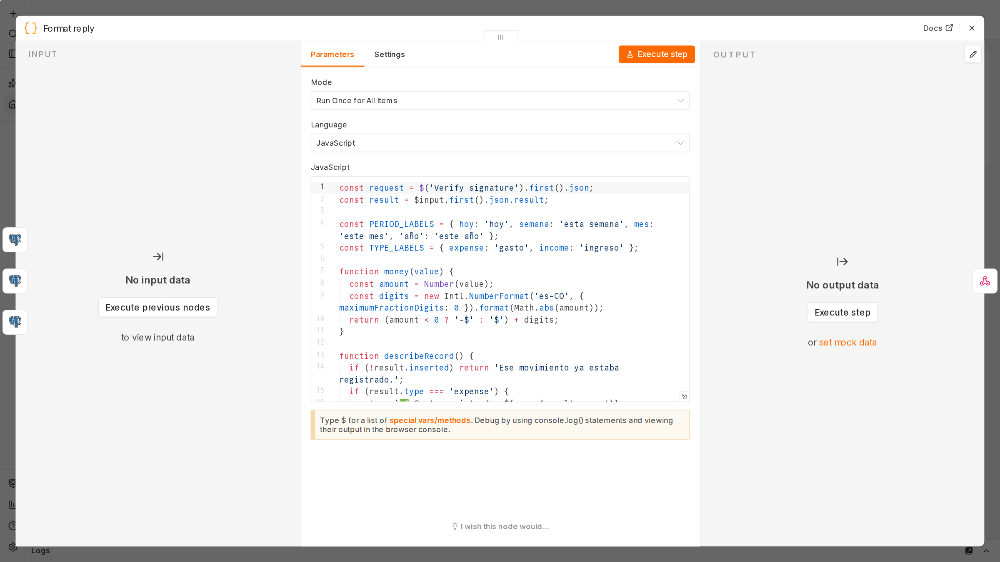

## 12. Build database error

Se ejecuta cuando falla un nodo de Postgres. Para `/gasto` y `/ingreso` responde
`⚠️ No pude guardar el movimiento...`; en los demás casos, `⚠️ Algo salió mal...`.

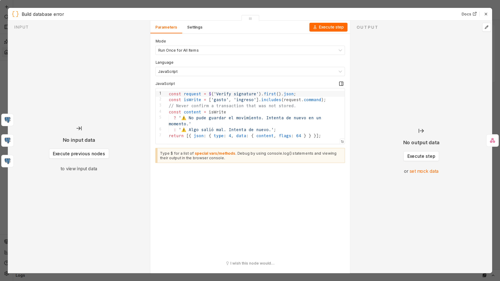

## 13. Reply

Nodo *Respond to Webhook* que devuelve a Discord el mensaje que le haya llegado.
Discord descarta las respuestas que tardan más de 3 segundos; las pruebas de extremo a extremo imponen un
presupuesto de 2.5 segundos.

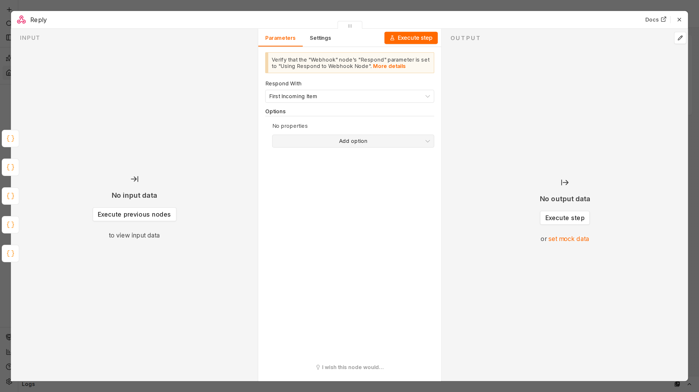
